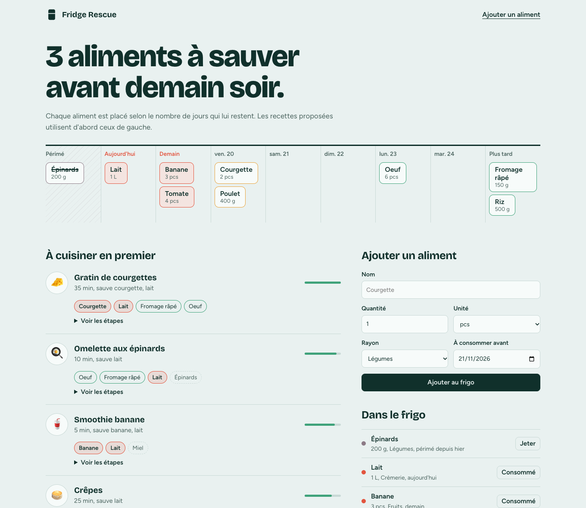
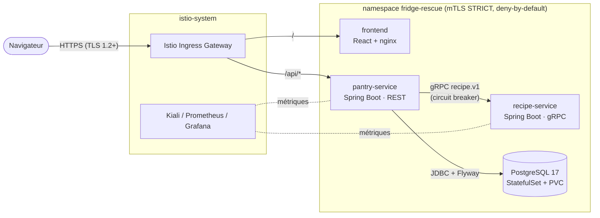

# Fridge Rescue 🥕

[](https://github.com/AissaMehenni/fridge-rescue/actions/workflows/ci.yml)

**Fridge Rescue est une application anti-gaspillage alimentaire en microservices.** On enregistre le
contenu de son frigo avec les dates de péremption ; l'application propose des recettes qui
utilisent **en priorité les aliments qui vont périmer**.

Projet du cours *Cloud Integration*, EFREI (B. Charroux) : REST, gRPC, Docker, Kubernetes,
Istio, PostgreSQL, sécurité du cluster, front React et préparation au déploiement cloud.



## Architecture



| Composant | Rôle | Technologies |
|---|---|---|
| `pantry-service` | Inventaire du frigo (CRUD, fraîcheur, statistiques), façade REST du front, client gRPC | Java 17, Spring Boot 3.5, JPA, Flyway, PostgreSQL / H2 |
| `recipe-service` | Moteur de suggestions : classe les recettes selon l'urgence des ingrédients | Spring Boot 3.5, Spring gRPC, protobuf |
| `recipe-contract` | Contrat `.proto` partagé, génère messages et stubs | protobuf 4.32, grpc-java 1.76 |
| `frontend` | Frise « jour par jour », recettes classées, ajout / consommation | React 19, Vite 8, nginx non root |

Détails, choix techniques et **tableau critère de notation → preuve** : [docs/ARCHITECTURE.md](docs/ARCHITECTURE.md).

## Prérequis

| Outil | Version testée |
|---|---|
| Docker Desktop (buildx, containerd store) | 29.9 |
| minikube | 1.39 (Kubernetes 1.37) |
| kubectl | 1.36+ |
| istioctl | 1.32 |
| JDK | 17 (Temurin) |
| Node.js | 24 |
| trivy, kubeconform | 0.76, 0.8 (optionnels : scan et validation) |

Docker Desktop doit disposer d'au moins **9 Go de mémoire** pour un minikube à 8 Go
(sinon : `make up MINIKUBE_MEMORY=7168`).

## Démarrage rapide (5 commandes)

```bash
git clone https://github.com/AissaMehenni/fridge-rescue.git && cd fridge-rescue
make test     # tests Java (dont PostgreSQL via Testcontainers) + front
make images   # images locales des 3 composants
make up       # minikube + Istio + observabilité + TLS + déploiement
make open     # https://localhost:8443  (dans un second terminal : make demo)
```

`make help` liste toutes les cibles. Le script de démo de 3 minutes est décrit dans [docs/DEMO.md](docs/DEMO.md).

## API

| Méthode | Chemin | Description |
|---|---|---|
| `GET` | `/api/items` | Aliments triés par date de péremption (`daysLeft`, `freshness`) |
| `GET` | `/api/items/expiring?days=3` | Aliments qui périment sous N jours |
| `GET` | `/api/items/stats` | Compteurs périmé / urgent / bientôt / frais |
| `POST` `PUT` `DELETE` | `/api/items[/{id}]` | Gestion du frigo (validation, erreurs RFC 9457) |
| `GET` | `/api/suggestions?limit=6` | Recettes classées (appel gRPC), `available=false` en mode dégradé |
| `GET` | `/api/recipes` | Catalogue complet (gRPC `ListRecipes`) |

Contrat gRPC : [`recipe.proto`](recipe-contract/src/main/proto/fridgerescue/recipe/v1/recipe.proto).

## Arborescence

```
recipe-contract/   contrat protobuf partagé
recipe-service/    serveur gRPC (moteur de suggestions)
pantry-service/    API REST + client gRPC + persistance
frontend/          React + Vite, servi par nginx
k8s/base/          manifests Kustomize (workloads, Istio, sécurité, PostgreSQL)
k8s/overlays/      dev (minikube) et cloud (GKE / AKS)
infra/istio/       configuration d'installation d'Istio
scripts/           génération TLS, démo
docs/              architecture, démo, déploiement cloud
```

## Sécurité en bref

mTLS STRICT, AuthorizationPolicy fondées sur l'identité SPIFFE, NetworkPolicy en refus par défaut,
RBAC à moindre privilège, conteneurs non root en lecture seule, HTTPS sur la gateway, scan trivy
bloquant en CI, aucun secret dans git. Voir [docs/ARCHITECTURE.md#sécurité](docs/ARCHITECTURE.md#sécurité).

## Déploiement cloud

Overlay `k8s/overlays/cloud` (HPA, PDB, répartition par zone, disque managé) et procédure GKE / AKS :
[docs/CLOUD.md](docs/CLOUD.md).
