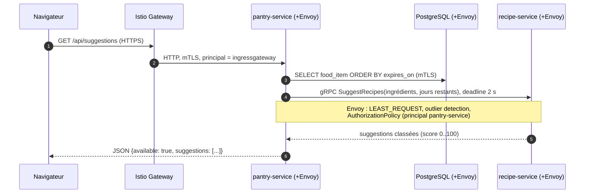

# Architecture et choix techniques

## Critère de notation → preuve dans le dépôt

| Palier | Critère | Preuve | Vérification |
|---|---|---|---|
| 10 | Service REST en local | [`pantry-service`](../pantry-service) (Spring Boot 3.5, Java 17, Actuator) | `make test` |
| 10 | Dockerfile | [`pantry-service/Dockerfile`](../pantry-service/Dockerfile) : multi-stage, couches Spring Boot, uid 10001 | `make images` |
| 10 | Image sur Docker Hub | `aissiuuuu/fridge-*:<version>`, multi-arch amd64 + arm64 ([CI](../.github/workflows/ci.yml), `make push`) | `docker buildx imagetools inspect` |
| 10 | Deployment + Service | [`k8s/base/pantry`](../k8s/base/pantry) : requests/limits, sondes startup/liveness/readiness | `kubectl -n fridge-rescue get deploy,svc` |
| 12 | Gateway | [`k8s/base/istio`](../k8s/base/istio) : Istio `Gateway` + `VirtualService` (routes `/api` et `/`) | `make open` |
| 14 | Second service relié au premier | [`recipe-service`](../recipe-service), appelé par pantry via [`RecipeClient`](../pantry-service/src/main/java/fr/efrei/fridgerescue/pantry/recipes/RecipeClient.java) | `curl /api/suggestions` |
| 14 (bonus) | gRPC | Contrat [`recipe.proto`](../recipe-contract/src/main/proto/fridgerescue/recipe/v1/recipe.proto), Spring gRPC 0.12, sonde gRPC native | `make demo` étape 3 |
| 14 | Service mesh | Sidecars injectés (`istio-injection: enabled`), [DestinationRule + circuit breaker](../k8s/base/recipe/destinationrule.yaml), retries et timeouts | `make kiali`, `make demo` étape 8 |
| 14 | Observabilité | Prometheus, Grafana, Kiali (`make observability`), endpoint `/actuator/prometheus` | `istioctl dashboard kiali` |
| 16 | BD en mémoire | H2 embarquée par défaut (tests, lancement local) | `./gradlew :pantry-service:bootRun` |
| 16 | PostgreSQL | [`k8s/base/postgres`](../k8s/base/postgres) : StatefulSet, PVC (`volumeClaimTemplates`), Service headless, ConfigMap, Secret | `kubectl -n fridge-rescue get sts,pvc` |
| 16 | Migrations | [Flyway V1/V2](../pantry-service/src/main/resources/db/migration), `ddl-auto: validate`, test Testcontainers | `PostgresMigrationIT` |
| 18 | RBAC | [`rbac.yaml`](../k8s/base/security/rbac.yaml) : Roles viewer / deployer, un ServiceAccount par workload, pas de jeton monté | `make demo` étape 7 |
| 18 | mTLS | [`PeerAuthentication` STRICT](../k8s/base/security/peerauthentication.yaml) | `make demo` étape 4 |
| 18 | Autorisation L7 | [`AuthorizationPolicy`](../k8s/base/security/authorizationpolicies.yaml) : refus par défaut, autorisation par identité SPIFFE | `make demo` étape 5 |
| 18 | Réseau | [`NetworkPolicy`](../k8s/base/security/networkpolicies.yaml) : refus en entrée par défaut, sortie restreinte des backends | `make demo` étape 6 |
| 18 | HTTPS | Gateway 443 TLS ≥ 1.2, redirection 80 → 443, [CA locale](../scripts/gen-tls.sh) | `curl -v https://…` |
| 18 | Sécurisation des images / du registry | Scan trivy bloquant (`make scan`, CI), SBOM + provenance au push, versions figées, jamais `latest` | `make scan` |
| 18 | Conteneurs | `runAsNonRoot`, `readOnlyRootFilesystem`, `drop: [ALL]`, seccomp `RuntimeDefault`, Pod Security en `warn/audit: restricted` | `kubectl get pod -o yaml` |
| 18 | Secrets hors du code | `secretGenerator` depuis un fichier ignoré par git (`make secrets`), certificats dans `certs/` (ignoré) | `git check-ignore -v` |
| 20 | Cloud (préparation) | [`k8s/overlays/cloud`](../k8s/overlays/cloud) (HPA, PDB, zones, disque managé) et [CLOUD.md](CLOUD.md) | `make validate OVERLAY=k8s/overlays/cloud` |
| + | Front | [`frontend`](../frontend) : React 19 + Vite, responsive, mode sombre, accessible | `make open` |
| + | Qualité | CI GitHub Actions, 23 tests Java, 6 tests front, kubeconform, Makefile | onglet Actions |

## Flux d'une requête « suggestions »



Si `recipe-service` ne répond pas (panne, éjection par le circuit breaker, deadline dépassée), pantry
renvoie `{available: false}` en quelques millisecondes et le front affiche un message clair, sans
bloquer la gestion du frigo.

## Algorithme de suggestion

Pour chaque recette, avec *j* le nombre de jours restants d'un ingrédient présent :

```
urgence(j)  = 1 / (1 + j)                       aujourd'hui = 1, demain = 0,5…
couverture  = ingrédients présents / ingrédients de la recette
sauvetage   = min(1, Σ urgence)
score       = 100 × (0,5 × couverture + 0,5 × sauvetage)
```

Les aliments périmés ne sont jamais proposés et une recette sans aucun ingrédient du frigo est
écartée. Les noms sont normalisés (casse, accents, pluriel simple) : « Épinards » = « epinard ».

## Choix techniques

| Sujet | Choix | Raison |
|---|---|---|
| Versions | Spring Boot 3.5.16, Spring gRPC 0.12.0 (gRPC 1.76, protobuf 4.32.1) | Spring gRPC 0.12 cible Boot 3.5 ; protoc et le plugin gRPC existent en `osx-aarch_64` |
| Build | Gradle 8.14 multi-projet, contrat dans un module dédié | Le `.proto` est la source unique pour le client et le serveur |
| Images | Compilation sur `$BUILDPLATFORM`, runtime JRE par architecture | Le jar est portable : une seule compilation, pas d'émulation QEMU pour Gradle |
| gRPC en clair dans l'application | `negotiation-type: plaintext` | Le chiffrement et l'identité sont délégués au sidecar (mTLS Istio) |
| Démarrage | Sidecars natifs Istio + initContainer `wait-for-postgres` | Flyway ne démarre qu'avec une base joignable : aucun redémarrage en cascade |
| Données de démo | Marqueur `demo_seed` (clé primaire) dans la même transaction | Deux répliques qui démarrent en même temps ne chargent les données qu'une fois |
| Secrets | `secretGenerator` + suffixe de hash | Un changement de secret redémarre automatiquement les pods |

## Sécurité

Défense en profondeur, chaque couche étant vérifiée par `make demo` :

1. **Bordure** : seule la gateway est exposée, en HTTPS (TLS ≥ 1.2), avec redirection HTTP → HTTPS.
2. **Identité** : un ServiceAccount par workload, donc un certificat SPIFFE par workload.
   `automountServiceAccountToken: false` partout, puisqu'aucune application n'appelle l'API Kubernetes.
3. **Chiffrement** : `PeerAuthentication` STRICT, donc tout trafic en clair est refusé.
4. **Autorisation L7** : `deny-all`, puis ouverture flux par flux (gateway → pantry sur `/api/*`
   et méthodes listées ; pantry → recipe sur le seul service gRPC ; pantry → postgres:5432). Un pod qui
   copie les labels de pantry mais n'a pas son identité reçoit `PERMISSION_DENIED`.
5. **Réseau L3/L4** : NetworkPolicy en refus par défaut, indépendante d'Istio ; les backends ne peuvent
   sortir que vers le DNS et istiod.
6. **RBAC humain / CI** : `fridge-viewer` en lecture seule, `fridge-deployer` qui ne peut que mettre à jour
   des déploiements ; aucun des deux ne lit les Secrets.
7. **Conteneurs** : non root, système de fichiers racine en lecture seule (`emptyDir` pour `/tmp`), aucune
   capability, seccomp `RuntimeDefault`, `allowPrivilegeEscalation: false`.
8. **Chaîne d'approvisionnement** : versions figées (images et dépendances), scan trivy bloquant,
   dépendances transitives vulnérables remontées à leur version corrigée dans
   [`build.gradle`](../build.gradle), SBOM et provenance publiés avec les images.

Risques acceptés, documentés dans [`.trivyignore`](../.trivyignore) :

- deux CVE de `spring-webmvc` 6.2.19, corrigées seulement en Spring 7 / Boot 4, hors périmètre imposé.
  Elles ne s'appliquent pas ici : pas de `XsltView`, pas de SSE.
- les CVE du binaire `gosu` de l'image PostgreSQL ne sont pas exploitables, car le conteneur démarre
  directement en uid 70 et gosu ne s'exécute jamais.
- Pod Security n'est pas en mode `enforce: restricted`, car le conteneur `istio-init` requiert `NET_ADMIN`.
  La piste d'amélioration est le plugin Istio CNI.
